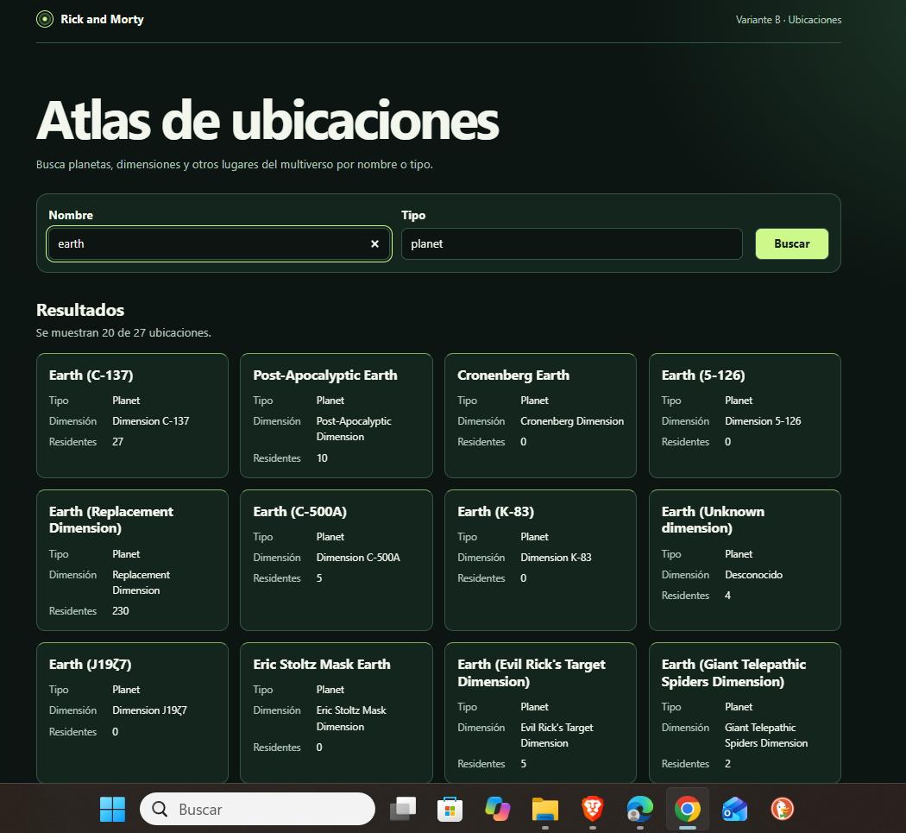

# Atlas de ubicaciones

Explorador de ubicaciones de Rick and Morty. Permite buscar planetas, dimensiones y otros lugares del multiverso por nombre y tipo, y consultar sus datos sin recorrer listados completos.

**Autora:** Rossana Ibarra · Fundamentos de Desarrollo Web · UCSA

**Variante del TP:** B · Ubicaciones

## Sitios publicados

- GitHub Pages: https://roxxanlab.github.io/tp-ibarra-rossana/
- Vercel: https://tp-ibarra-rossana.vercel.app/

## Captura



## Funcionalidades

- Buscar ubicaciones por nombre, tipo o ambos criterios.
- Ver el nombre, el tipo, la dimensión y la cantidad de residentes de cada ubicación.
- Consultar hasta 20 ubicaciones de la primera página y ver el total de coincidencias.
- Recuperar los criterios y repetir la última búsqueda al recargar la página.
- Limpiar los filtros, los resultados y la búsqueda guardada.
- Consultar el estado de la búsqueda durante la carga, cuando no hay coincidencias y si falla la conexión.

## Tecnologías

- HTML5 y CSS3, con Flexbox y Grid para el diseño adaptable.
- JavaScript (ES6+), DOM, Fetch API y `localStorage`.
- [API REST de Rick and Morty](https://rickandmortyapi.com/documentation), con el endpoint `/api/location`.

## Estructura del proyecto

```text
tp-ibarra-rossana/
├── .gitignore          Archivos locales excluidos del repositorio
├── README.md           Documentación técnica
├── index.html          Formulario, resultados y pie con la versión
├── css/
│   └── estilos.css     Diseño adaptable, formulario y tarjetas
├── js/
│   └── app.js          Consultas, estados, resultados y persistencia
└── img/
    └── captura.png     Ejemplo de resultados usado en este README
```

## Cómo ejecutarlo localmente

1. Ejecuta `git clone https://github.com/roxxanlab/tp-ibarra-rossana.git`.
2. Abre `index.html` en el navegador o con Live Server. También puedes ejecutar `python -m http.server 8000` desde la carpeta del proyecto y abrir `http://localhost:8000`.
3. Prueba con **Earth** como nombre y **Planet** como tipo. Se necesita conexión a Internet para consultar la API.

## Despliegue

GitHub Pages y Vercel publican la raíz de la rama `main`. Vercel usa el preset Other y sirve los archivos estáticos sin un paso de compilación. Cada `push` a `main` actualiza ambas publicaciones automáticamente. El número de versión en el pie permite comprobar qué versión se publicó.
